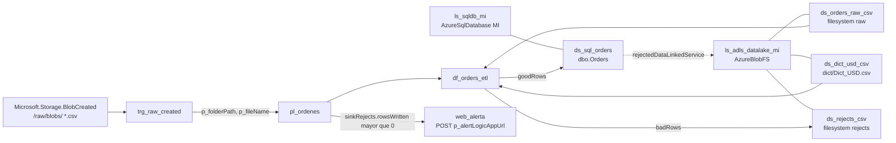
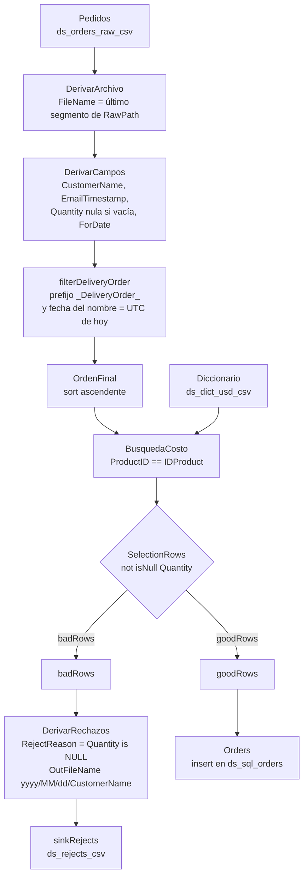
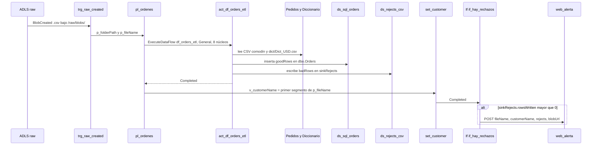

# Diagrams — Explicación funcional

1) Arquitectura
Propósito
Describir de extremo a extremo cómo un adjunto .csv enviado por correo termina transformado y cargado en Azure SQL, con control de calidad, rechazos trazables y alertas.

## Componentes y rol

- Correo (Outlook): origen de datos; el usuario envía adjuntos .csv.
- Logic App Ingesta: recibe el correo, extrae el adjunto y lo guarda en ADLS Gen2 /raw/.
- ADLS Gen2 (/raw/): landing zone de archivos; emite el evento Blob creado.
- Azure Data Factory – Pipeline pl_ordenes: se dispara por el evento; orquesta la ejecución del Data Flow.
- Data flow df_orders_etl (actividad act_df_orders_etl): deriva columnas y separa goodRows y badRows.
- Azure SQL (dbo.Orders): destino de filas válidas, vía el dataset `ds_sql_orders`.
- ADLS Gen2 (/rejects/): destino de filas rechazadas, vía el dataset `ds_rejects_csv`.
- Logic App Alerta: HTTP trigger; envía correo de alerta cuando existen rechazos.
- Flujo lógico (resumen operativo)
- Correo llega con .csv → Logic App lo deposita en /raw/.
- Evento “blob creado” dispara pl_ordenes.
- pl_ordenes ejecuta act_df_orders_etl.
- El Data Flow deriva metadatos del nombre de archivo, enriquece con diccionario, valida y split:
- good_rows → dbo.Orders.
- bad_rows → /rejects/.
- Si sinkRejects.rowsWritten es mayor que 0, web_alerta hace POST a p_alertLogicAppUrl. El correo lo enviaría la Logic App de alerta. Esa definición no está en el repositorio.

## Condiciones clave/negocio

- Disparo por evento.
- Rechazo cuando `Quantity` queda nula o vacía en `DerivarCampos` (`dataflow/df_orders_etl.json`).
- Trazabilidad por FileName en todos los sinks.

Observabilidad recomendada

- Métricas por ejecución: archivos procesados, filas válidas/rechazadas, tiempo total.
- Identificadores en el JSON: p_fileName y v_customerName. v_fileName está declarada y ninguna actividad la usa. df_fileName no está en el flujo.

Diagrama derivado de `factory/adf-orders-pipeline.json`, `trigger/trg_raw_created.json`, `pipeline/pl_ordenes.json`, `dataflow/df_orders_etl.json`, `dataset/` y `linkedService/`. La factoría es `adf-orders-pipeline` (`mexicocentral`, identidad `SystemAssigned`). El correo y la Logic App de ingesta no están en esos JSON; el desencadenador empieza en el evento de blob.

## 2) Flujo detallado dentro del Data Flow

### Entradas

- Pedidos CSV (raw) con RawPath para derivar FileName.
- Diccionario CSV para enriquecer costo.
- Derivaciones/metadatos
- FileName desde RawPath.
- CustomerName por prefijo del FileName.
- EmailTimestamp derivado del FileName.
- ForDate si aplica.
- Transformaciones
- Normalización de Quantity y tipos.
- Select/orden de columnas hacia dbo.Orders.
- Lookup por clave de producto contra diccionario.
- Validación y split
- Válida: `not(isNull(Quantity))` después de convertir `Quantity`.
- good_rows → dbo.Orders.
- bad_rows → derivar RejectReason y OutFileName → /rejects/.

Trazabilidad
- Propagar FileName y timestamps en ambos sinks.
- Consistencia de esquema entre Select final y tabla SQL.
- Errores típicos detectables
- Desalineo CSV ↔ esquema.
- Lookup fallido por claves nulas/desconocidas.
- Patrón de nombre de archivo incumplido.

Diagrama derivado de `scriptLines` en `dataflow/df_orders_etl.json`. `Pedidos` lee la ruta comodín `2025/08/28/BestLocalPizza_DeliveryOrder_20250828T053149Z.csv` y guarda la URL de fila en `RawPath`.

`filterDeliveryOrder` exige que el nombre empiece por `<prefijo>_DeliveryOrder_` y que el último segmento `_` coincida exactamente con `yyyyMMdd'T'HHmmss'Z'`. Los cuatro CSV de `samples/` terminan en `DeliveryOrder.csv`, así que el prefijo falla. En la ruta comodín el último segmento es `20250828T053149Z.csv`: el `.csv` queda dentro del segmento y el patrón no coincide. El script local `classify_order_row` no aplica este filtro. Separa solo por `Quantity`.

## 3) Secuencia extremo a extremo (E2E)

### Objetivo
Visualizar la temporalidad y la interacción entre actores y servicios desde el envío del correo hasta la notificación final.

## Secuencia narrativa

- Usuario envía correo con adjunto .csv → Outlook.
- Logic App Ingesta toma adjunto y guarda en ADLS /raw/.
- ADLS emite evento de blob creado → ADF pl_ordenes.
- ADF ejecuta Data Flow act_df_orders_etl.
- Data Flow inserta válidos en dbo.Orders y rechazos en /rejects/.
- Si hubo rechazos: ADF invoca Logic App Alerta (HTTP POST) → correo.

## Puntos de control

- Idempotencia por nombre de archivo/fecha en reintentos.
- Manejo de duplicados.
- Retención de archivos en /raw/ y /rejects/.

## Resultado esperado

- Datos confiables en dbo.Orders.
- Rechazos documentados y accionables.
- Notificación inmediata si hay incidencias.

Diagrama derivado de `trigger/trg_raw_created.json` y de las dependencias `Completed` en `pipeline/pl_ordenes.json`. `p_storageAccountName` y `p_alertLogicAppUrl` no los envía el desencadenador; usan su valor predeterminado.

