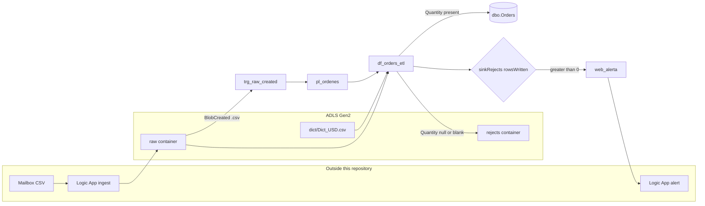
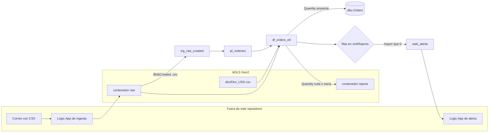

# Azure Data Factory — order CSV ingestion pipeline

Land synthetic delivery-order CSVs in ADLS Gen2, load rows with a usable `Quantity` into Azure SQL, and write the other rows to a reject path with an alert.

Portfolio project for **Edgar Flores**, Data & AI Engineer. This is an Azure Data Factory Git export. The files in `samples/` are synthetic orders written for this portfolio. Storage account names, SQL server names, subscription ids, and the alert URL are placeholders. Replace them before publishing. See [Placeholders](#placeholders).

Browser checker: https://eflores1122.github.io/azure-adf-orders-pipeline/

## Problem

Order files arrive as CSV drops. `Quantity` is sometimes blank, and one supplier file uses `Qty` instead. Valid rows belong in `dbo.Orders`. Rejected rows go to ADLS with `RejectReason = 'Quantity is NULL'`, and the pipeline POSTs a short JSON body when that reject sink wrote any rows. Linked services use the factory managed identity. The Git export keeps account keys, SQL passwords, subscription ids, server names, and connection strings out of the files.

## Tech stack

| Piece | Role |
| --- | --- |
| Azure Data Factory | Pipeline `pl_ordenes`, mapping data flow `df_orders_etl`, blob-created trigger |
| ADLS Gen2 | `raw` landing, `dict/Dict_USD.csv`, `rejects` output |
| Azure SQL Database | Sink `dbo.Orders` |
| Managed identity | `ls_adls_datalake_mi` and `ls_sqldb_mi` |
| Python 3.12 | `scripts/validate_adf.py` replays the `Quantity` split on the sample CSVs |
| pytest, Ruff | Tests and lint, both run in GitHub Actions |
| GitHub Pages | Static page in `site/` that runs the same split in the browser |

## Documentation

- [Mapping (EN)](docs/Mapping.md) — field mapping and design notes
- [Mapeo (ES)](Mapeo.md) — the same design notes in Spanish
- [Diagrams (ES)](Diagrams.md) — architecture, data-flow, and end-to-end sequence diagrams

The JSON in this repository is the checked-in behavior. The mapping notes also describe expressions (a `Qty` fallback and a `df_fileName` parameter) that are not connected in `dataflow/df_orders_etl.json`.

## Repository layout

| Path | Contents |
| --- | --- |
| `factory/` | Factory name, region, and system-assigned identity placeholders |
| `pipeline/pl_ordenes.json` | Pipeline `pl_ordenes` |
| `dataflow/df_orders_etl.json` | Mapping data flow `df_orders_etl` |
| `dataset/` | Raw CSV, dictionary CSV, rejects CSV, and `dbo.Orders` |
| `linkedService/` | ADLS Gen2 and Azure SQL linked services (managed identity) |
| `trigger/trg_raw_created.json` | Blob Created trigger on the `raw` container |
| `samples/` | Synthetic order CSVs used by the local reject-split check |
| `sql/dbo.Orders.sql` | `CREATE TABLE` matching the Orders sink columns |
| `scripts/validate_adf.py` | Structural checks, sample-CSV split, and identifier scan |
| `scripts/assemble_site.py` | Copies `site/` and `samples/` into the Pages artifact `_site/` |
| `site/` | Browser page that runs the same reject split |
| `tests/` | pytest suite for those checks |
| `publish_config.json` | ADF publish branch (`adf_publish`) |
| `.github/workflows/ci.yml` | Ruff, validation, and pytest, with no secrets |
| `.github/workflows/pages.yml` | GitHub Pages deploy on push to `main` |

This is the folder layout ADF writes in Git mode. Logic App definitions are not in this repository. The pipeline only calls an alert URL parameter.

## Architecture



1. A blob trigger (`trg_raw_created`) listens for `.csv` blobs under `/raw/blobs/` and starts `pl_ordenes` with `p_folderPath` and `p_fileName` from the event.
2. `pl_ordenes` runs `df_orders_etl`.
3. The data flow reads `dict/Dict_USD.csv` and the raw orders CSV, derives file metadata, looks up `ProductID` in the dictionary, and splits on `Quantity`.
4. Rows with a converted `Quantity` go to `dbo.Orders`. Rows whose `Quantity` is null or blank go to the `rejects` container with `RejectReason = 'Quantity is NULL'`.
5. If `sinkRejects.rowsWritten` is greater than 0, activity `web_alerta` POSTs JSON to `p_alertLogicAppUrl`.

The ingest Logic App in the diagram is the upstream design described in `Diagrams.md`. Its definition is not exported here.

## What the pipeline does

Activities, in order:

1. `act_df_orders_etl` runs data flow `df_orders_etl` on a General 8-core compute. The activity does not pass data-flow parameters.
2. `set_customer` sets `v_customerName` to the first `_` segment of `p_fileName`. If `p_fileName` is empty, the expression uses `BestLocalPizza_DeliveryOrder_20250828T053149Z.csv`.
3. `If if_hay_rechazos` is true when `activity('act_df_orders_etl').output.runStatus.metrics.sinkRejects.rowsWritten` is greater than 0. The true branch POSTs:

```json
{
  "fileName": "<p_fileName>",
  "customerName": "<v_customerName>",
  "rejects": "<sinkRejects.rowsWritten>",
  "blobUrl": "https://<p_storageAccountName>.blob.core.windows.net/raw/<folder>/<file>"
}
```

Pipeline parameters:

| Parameter | Default | Supplied by the trigger |
| --- | --- | --- |
| `p_folderPath` | none | `@triggerBody().folderPath` |
| `p_fileName` | none | `@triggerBody().fileName` |
| `p_storageAccountName` | `<storage-account-name>` | uses the default |
| `p_alertLogicAppUrl` | `<logic-app-http-trigger-url>` | uses the default |

`v_fileName` is declared and is not set or read by any activity in `pl_ordenes.json`.

## Data flow rules

Checked-in script in `dataflow/df_orders_etl.json`:

- `FileName` comes from `substringIndex(RawPath, '/', -1)` (`RawPath` is the source row URL).
- `CustomerName` is the first `_` segment of `FileName`.
- `EmailTimestamp` parses the value after `DeliveryOrder_` with pattern `yyyyMMdd HHmmss`.
- `Quantity` becomes null when the source value is null or blank; otherwise `toInteger(Quantity)`.
- `ForDate` uses `d/M/yyyy`, or null when blank.
- `filterDeliveryOrder` keeps a name that starts with `<prefix>_DeliveryOrder_` only when the last `_` segment matches `yyyyMMdd'T'HHmmss'Z'` and that date is the current UTC date. The four names in `samples/` end in `DeliveryOrder.csv`, so the prefix fails. On `BestLocalPizza_DeliveryOrder_20250828T053149Z.csv` the last segment is `20250828T053149Z.csv`, and the `.csv` suffix keeps the pattern from matching.
- `BusquedaCosto` looks up `ProductID == IDProduct` in the dictionary (one match, any pick).
- `SelectionRows` sends `not(isNull(Quantity))` to `goodRows` and the remaining rows to `badRows`.
- Rejected rows get `RejectReason = 'Quantity is NULL'` and an `OutFileName` under `yyyy/MM/dd/<CustomerName>/`.

The orders source uses this wildcard path:

`2025/08/28/BestLocalPizza_DeliveryOrder_20250828T053149Z.csv`

The dictionary source has `ignoreNoFilesFound: false`, so a missing `dict/Dict_USD.csv` fails the data flow. That dictionary file is not in `samples/`.

## SQL the orders sink expects

`dataset/ds_sql_orders.json` targets schema `dbo`, table `Orders`. [`sql/dbo.Orders.sql`](sql/dbo.Orders.sql) lists every column in the Orders sink `mapColumn`. CI reads that file as text. Publishing still means running it yourself on Azure SQL.

```sql
CREATE TABLE dbo.Orders (
  ProductID           nvarchar(50)   NOT NULL,
  ProductDescription  nvarchar(200)  NOT NULL,
  Quantity            int            NULL,
  UOM_ID              nvarchar(20)   NULL,
  ForDate             date           NULL,
  AddressID           nvarchar(50)   NULL,
  ContactID           nvarchar(50)   NULL,
  Sale                decimal(18,2)  NULL,
  RawPath             nvarchar(1000) NULL,
  FileName            nvarchar(260)  NULL,
  CustomerName        nvarchar(100)  NULL,
  EmailTimestamp      datetime2(0)   NULL,
  IDProduct           nvarchar(50)   NULL,
  [Sale Cost (USD)]   decimal(18,4)  NULL
);
```

`Mapeo.md` also shows `dbo.OrdersRejects` and `dbo.Contacts`. No dataset in this repo writes those tables.

## Samples and the local reject split

The local check follows the data-flow split: a row is good when `Quantity` is present and `toInteger` can convert it. A null, blank, or non-numeric `Quantity` is a reject. A missing `Quantity` column is treated as null. The check reads `Quantity`, the same column `DerivarCampos` converts.

| Sample | Result under that rule |
| --- | --- |
| `samples/BestLocalPizza_DeliveryOrder.csv` | 6 good, 1 reject (blank `Quantity`) |
| `samples/TaqueriaElSol_DeliveryOrder.csv` | 8 good |
| `samples/TortasElRey_DeliveryOrder.csv` | 8 good |
| `samples/FastFoodNY_DeliveryOrder.csv` | 10 reject (`Qty` is present, `Quantity` is not) |

Node.js 20 or newer is required. `pytest` compares `site/js/classify.js` with the Python rule by calling `node`.

```bash
python -m pip install -r requirements-dev.txt
python -m ruff check .
python -m ruff format --check .
python scripts/validate_adf.py
python -m pytest
```

Sample output from this checkout:

```text
samples/BestLocalPizza_DeliveryOrder.csv: 6 good, 1 reject rows [8]
samples/FastFoodNY_DeliveryOrder.csv: 0 good, 10 reject rows [2, 3, 4, 5, 6, 7, 8, 9, 10, 11]
samples/TaqueriaElSol_DeliveryOrder.csv: 8 good, 0 reject
samples/TortasElRey_DeliveryOrder.csv: 8 good, 0 reject
ADF validation OK
```

GitHub Actions runs the same lint, validation, and tests on push and pull request. The workflow has no secrets. The validator fails the build when a file contains a subscription id, a concrete storage or SQL host, or a connection string.

## Browser

[site/index.html](site/index.html) runs `classify_order_row` in the browser. Pick one of the four files in `samples/`, or upload a CSV. The table marks each row valid or rejected and gives the reason. Counts for the sample files match `python scripts/validate_adf.py`.

The page also evaluates `filterDeliveryOrder` for the file name and shows whether `web_alerta` would POST. It does not start Data Factory and it does not read `dict/Dict_USD.csv`. A published data flow fails when that dictionary is missing (`ignoreNoFilesFound: false`).

`.github/workflows/pages.yml` publishes the page on every push to `main` and on `workflow_dispatch`. `python scripts/assemble_site.py` builds the `_site/` artifact.

## Placeholders

| Placeholder | Where it is set |
| --- | --- |
| `<storage-account-name>` | `ls_adls_datalake_mi` parameter `storageAccountName`, each ADLS dataset, the data-flow rejected-rows linked service, pipeline parameter `p_storageAccountName`, and the blob trigger scope |
| `<sql-server-name>` | `ls_sqldb_mi` parameter `sqlServerName` (server label only; the host suffix `.database.windows.net` is in the linked service) |
| `<sql-database-name>` | `ls_sqldb_mi` parameter `sqlDatabaseName` and `ds_sql_orders` |
| `<subscription-id>`, `<resource-group>` | Blob trigger `scope` |
| `<tenant-id>`, `<managed-identity-principal-id>` | `factory/adf-orders-pipeline.json` identity |
| `<logic-app-http-trigger-url>` | Pipeline parameter `p_alertLogicAppUrl` |

`ls_adls_datalake_mi` keeps the account URL and managed-identity shape. It authenticates with the factory managed identity instead of an account key. `ls_sqldb_mi` uses `SystemAssignedManagedIdentity`.

Give the factory managed identity **Storage Blob Data Contributor** on the lake and permission to insert into `dbo.Orders`. Put a new Logic App HTTP trigger URL in `p_alertLogicAppUrl`. Do not commit a URL that includes a `sig` query parameter.

## Limits of the checked-in flow

- The orders source reads one hardcoded wildcard path, so the trigger file name does not select the CSV inside the data flow.
- `filterDeliveryOrder` drops the four sample names, and the hardcoded wildcard path does not match `yyyyMMdd'T'HHmmss'Z'` because the last `_` segment still ends in `.csv`. See the data flow rules above.
- `v_fileName` is unused, and the data flow has no `df_fileName` parameter.
- `FastFoodNY_DeliveryOrder.csv` uses `Qty`. Those rows fall into the reject stream under the checked-in `Quantity` expression.
- Publishing still requires a real factory, role assignments, `dict/Dict_USD.csv`, and the placeholder values above. `publish_config.json` points publish output at branch `adf_publish`.
- [`sql/dbo.Orders.sql`](sql/dbo.Orders.sql) is the sink shape. This repository does not apply it.

## License

[MIT](LICENSE). Font files under `site/fonts/` remain under the SIL Open Font License ([site/fonts/OFL.txt](site/fonts/OFL.txt)).

---

# Azure Data Factory — pipeline de ingesta de CSV de pedidos

La guía principal está en inglés, arriba. Esta sección describe el mismo flujo en español.

Proyecto de portafolio de **Edgar Flores**, Data & AI Engineer. Este repositorio es una exportación Git de Azure Data Factory. Los CSV de `samples/` son pedidos sintéticos escritos para el portafolio. Los nombres de storage, el servidor SQL, los identificadores de suscripción y la URL de alerta son marcadores. Hay que sustituirlos antes de publicar. La tabla está en [Placeholders](#placeholders).

Pila: Azure Data Factory, ADLS Gen2, Azure SQL, identidad administrada, Python 3.12, pytest, Ruff, GitHub Actions y GitHub Pages.

Sitio: https://eflores1122.github.io/azure-adf-orders-pipeline/

## Documentación

- [Mapping (EN)](docs/Mapping.md)
- [Mapeo (ES)](Mapeo.md)
- [Diagramas (ES)](Diagrams.md)

El JSON del repositorio es el comportamiento versionado. Las notas de mapeo también describen expresiones (respaldo de `Qty` y parámetro `df_fileName`) que no están conectadas en `dataflow/df_orders_etl.json`.

## Contenido

| Ruta | Contenido |
| --- | --- |
| `factory/` | Nombre de la factoría, región e identidad administrada con marcadores |
| `pipeline/pl_ordenes.json` | Canalización `pl_ordenes` |
| `dataflow/df_orders_etl.json` | Flujo de datos `df_orders_etl` |
| `dataset/` | CSV raw, diccionario, CSV de rechazos y `dbo.Orders` |
| `linkedService/` | ADLS Gen2 y Azure SQL (identidad administrada) |
| `trigger/trg_raw_created.json` | Desencadenador Blob Created sobre el contenedor `raw` |
| `samples/` | CSV sintéticos para la validación local del split |
| `sql/dbo.Orders.sql` | `CREATE TABLE` con las columnas del sink Orders |
| `scripts/validate_adf.py` | Validación estructural, split de CSV y búsqueda de identificadores |
| `scripts/assemble_site.py` | Copia `site/` y `samples/` al artefacto `_site/` |
| `site/` | Página que ejecuta el mismo corte de rechazos |
| `tests/` | Pruebas pytest |
| `publish_config.json` | Rama de publicación ADF (`adf_publish`) |
| `.github/workflows/ci.yml` | Ruff, validación y pytest, sin secretos |
| `.github/workflows/pages.yml` | Publicación en GitHub Pages al hacer push a `main` |

Las definiciones de Logic Apps no están en el repositorio. La canalización solo llama al parámetro de la URL de alerta.

## Arquitectura



1. `trg_raw_created` escucha blobs `.csv` bajo `/raw/blobs/` y arranca `pl_ordenes` con `p_folderPath` y `p_fileName`.
2. `pl_ordenes` ejecuta `df_orders_etl`.
3. El flujo lee `dict/Dict_USD.csv` y el CSV de pedidos, deriva metadatos del archivo, busca `ProductID` en el diccionario y separa por `Quantity`.
4. Las filas con `Quantity` convertida van a `dbo.Orders`. Las filas con `Quantity` nula o vacía van al contenedor `rejects` con `RejectReason = 'Quantity is NULL'`.
5. Si `sinkRejects.rowsWritten` es mayor que 0, `web_alerta` hace POST al parámetro `p_alertLogicAppUrl`.

La Logic App de ingesta del diagrama es el diseño previo descrito en `Diagrams.md`. Su definición no está exportada aquí.

## Canalización

1. `act_df_orders_etl` ejecuta `df_orders_etl` con cómputo General de 8 núcleos, sin parámetros de flujo.
2. `set_customer` asigna `v_customerName` al primer segmento de `p_fileName` separado por `_`. Si `p_fileName` viene vacío, la expresión usa `BestLocalPizza_DeliveryOrder_20250828T053149Z.csv`.
3. `If if_hay_rechazos` es verdadero cuando `sinkRejects.rowsWritten` es mayor que 0. La rama verdadera envía `fileName`, `customerName`, `rejects` y `blobUrl`.

| Parámetro | Valor predeterminado | Lo envía el desencadenador |
| --- | --- | --- |
| `p_folderPath` | ninguno | `@triggerBody().folderPath` |
| `p_fileName` | ninguno | `@triggerBody().fileName` |
| `p_storageAccountName` | `<storage-account-name>` | usa el predeterminado |
| `p_alertLogicAppUrl` | `<logic-app-http-trigger-url>` | usa el predeterminado |

`v_fileName` está declarada y ninguna actividad de `pl_ordenes.json` la asigna o la lee.

## Reglas del flujo de datos

- `FileName` sale de `substringIndex(RawPath, '/', -1)`.
- `CustomerName` es el primer segmento `_` de `FileName`.
- `EmailTimestamp` interpreta el texto posterior a `DeliveryOrder_` con el patrón `yyyyMMdd HHmmss`.
- `Quantity` queda nula si el origen es nulo o vacío; si no, usa `toInteger(Quantity)`.
- `ForDate` usa `d/M/yyyy`, o nulo si viene vacío.
- `filterDeliveryOrder` deja pasar un nombre que empieza con `<prefijo>_DeliveryOrder_` solo si el último segmento `_` coincide con `yyyyMMdd'T'HHmmss'Z'` y esa fecha es la UTC de hoy. Los cuatro nombres de `samples/` terminan en `DeliveryOrder.csv`, así que el prefijo falla. En `BestLocalPizza_DeliveryOrder_20250828T053149Z.csv` el último segmento es `20250828T053149Z.csv`: el sufijo `.csv` impide que el patrón coincida.
- `BusquedaCosto` hace lookup `ProductID == IDProduct`.
- `SelectionRows` envía `not(isNull(Quantity))` a `goodRows` y el resto a `badRows`.
- Los rechazos llevan `RejectReason = 'Quantity is NULL'` y `OutFileName` bajo `yyyy/MM/dd/<Cliente>/`.

El origen de pedidos usa la ruta comodín `2025/08/28/BestLocalPizza_DeliveryOrder_20250828T053149Z.csv`. El diccionario tiene `ignoreNoFilesFound: false`. Ese CSV no está en `samples/`.

## SQL que espera el sink

`ds_sql_orders` apunta a `dbo.Orders`. [`sql/dbo.Orders.sql`](sql/dbo.Orders.sql) incluye cada columna del `mapColumn` del sink. CI lee ese archivo como texto. Publicar implica ejecutarlo en Azure SQL.

```sql
CREATE TABLE dbo.Orders (
  ProductID           nvarchar(50)  NOT NULL,
  ProductDescription  nvarchar(200) NOT NULL,
  Quantity            int           NULL,
  UOM_ID              nvarchar(20)  NULL,
  ForDate             date          NULL,
  AddressID           nvarchar(50)  NULL,
  ContactID           nvarchar(50)  NULL,
  Sale                decimal(18,2)  NULL,
  RawPath             nvarchar(1000) NULL,
  FileName            nvarchar(260)  NULL,
  CustomerName        nvarchar(100)  NULL,
  EmailTimestamp      datetime2(0)   NULL,
  IDProduct           nvarchar(50)   NULL,
  [Sale Cost (USD)]   decimal(18,4)  NULL
);
```

`Mapeo.md` documenta `dbo.OrdersRejects` y `dbo.Contacts`. Ningún dataset de este repositorio escribe esas tablas.

## Muestras y validación local

Una fila es válida cuando `Quantity` existe y `toInteger` puede convertirla. Nula, vacía o no numérica cuenta como rechazo. Si falta la columna `Quantity`, la fila se rechaza. La validación lee `Quantity`, la misma columna que convierte `DerivarCampos`.

| Muestra | Resultado |
| --- | --- |
| `samples/BestLocalPizza_DeliveryOrder.csv` | 6 válidas, 1 rechazo |
| `samples/TaqueriaElSol_DeliveryOrder.csv` | 8 válidas |
| `samples/TortasElRey_DeliveryOrder.csv` | 8 válidas |
| `samples/FastFoodNY_DeliveryOrder.csv` | 10 rechazos (`Qty` presente, `Quantity` ausente) |

Hace falta Node.js 20 o posterior. `pytest` llama a `node` para comparar `site/js/classify.js` con la regla de Python.

```bash
python -m pip install -r requirements-dev.txt
python -m ruff check .
python -m ruff format --check .
python scripts/validate_adf.py
python -m pytest
```

La salida de `python scripts/validate_adf.py` en este checkout es la misma del bloque en inglés: 6 válidas y 1 rechazo en Best Local Pizza, 10 rechazos en FastFoodNY, 8 válidas en Taquería El Sol y 8 válidas en Tortas El Rey.

GitHub Actions ejecuta el lint, la validación y las pruebas en push y pull request, sin secretos. La validación falla si un archivo trae un id de suscripción, un host concreto de storage o SQL, o una cadena de conexión.

## Navegador

[site/index.html](site/index.html) ejecuta `classify_order_row` en el navegador. Se elige uno de los cuatro CSV de `samples/` o se sube otro. La tabla marca cada fila como válida o rechazo y muestra el motivo. Los conteos de las muestras coinciden con `python scripts/validate_adf.py`.

La página también evalúa `filterDeliveryOrder` para el nombre del archivo y muestra si `web_alerta` haría POST. No arranca Data Factory y no lee `dict/Dict_USD.csv`. El flujo publicado falla si ese diccionario no existe (`ignoreNoFilesFound: false`).

`.github/workflows/pages.yml` publica la página en cada push a `main` y con `workflow_dispatch`. `python scripts/assemble_site.py` construye el artefacto `_site/`.

## Marcadores

Sustituye `<storage-account-name>`, `<sql-server-name>` (sin el sufijo `.database.windows.net`), `<sql-database-name>`, `<subscription-id>`, `<resource-group>`, `<tenant-id>`, `<managed-identity-principal-id>` y `<logic-app-http-trigger-url>` en los JSON indicados en la sección en inglés.

`ls_adls_datalake_mi` conserva la URL de la cuenta y la forma de identidad administrada. Se autentica con la identidad administrada de la factoría en lugar de una clave de cuenta. `ls_sqldb_mi` usa `SystemAssignedManagedIdentity`.

Concede a la identidad de la factoría **Storage Blob Data Contributor** sobre el lago y permiso de inserción en `dbo.Orders`. Coloca una URL nueva del desencadenador HTTP de Logic App en `p_alertLogicAppUrl`, sin parámetro `sig`.

## Límites del flujo versionado

- El origen de pedidos lee una ruta comodín fija, así que el nombre de archivo del desencadenador no elige el CSV dentro del flujo.
- `filterDeliveryOrder` deja fuera los cuatro nombres de `samples/`. La ruta comodín tampoco coincide con `yyyyMMdd'T'HHmmss'Z'` porque el último segmento `_` sigue terminando en `.csv`. El detalle está en las reglas del flujo.
- `v_fileName` no se usa y el flujo no declara `df_fileName`.
- `FastFoodNY_DeliveryOrder.csv` usa `Qty`, así que esas filas caen en rechazos con la expresión actual de `Quantity`.
- Publicar exige una factoría real, roles, `dict/Dict_USD.csv` y los marcadores. `publish_config.json` envía la publicación a la rama `adf_publish`.
- [`sql/dbo.Orders.sql`](sql/dbo.Orders.sql) es la forma del sink. Este repositorio no lo aplica.

## Licencia

[MIT](LICENSE). Las fuentes en `site/fonts/` siguen bajo la SIL Open Font License ([site/fonts/OFL.txt](site/fonts/OFL.txt)).
