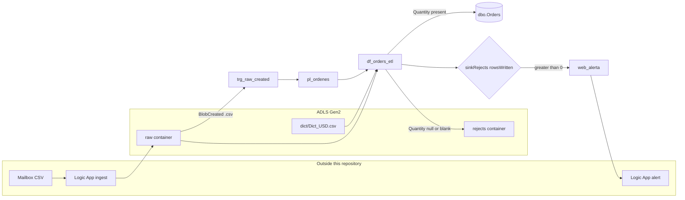
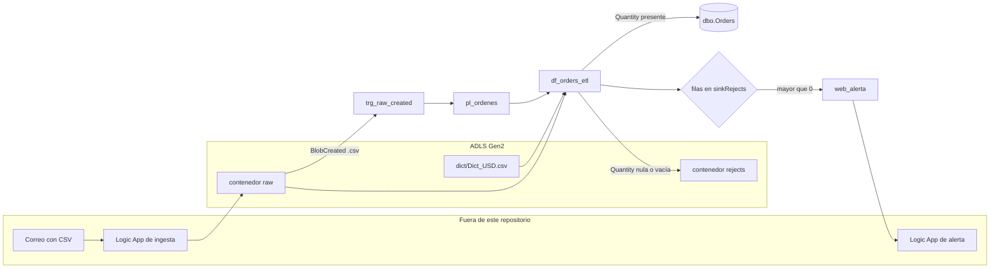

# Azure Data Factory — order CSV ingestion pipeline

Portfolio project for **Edgar Flores**, Data & AI Engineer. This repository is an Azure Data Factory Git export, built with sample data, for a delivery-order CSV flow: land files in ADLS Gen2, split rows in a mapping data flow, load valid rows to Azure SQL `dbo.Orders`, write rejected rows to ADLS, and POST an alert when rejects were written.

Infrastructure names, resource ids, and the alert webhook are placeholders. Replace them before publishing to a factory. See [Placeholders](#placeholders).

## Documentation

- [Mapping (EN)](docs/Mapping.md) — field mapping and design notes
- [Mapeo (ES)](Mapeo.md) — the same design notes in Spanish
- [Diagrams (ES)](Diagrams.md) — architecture, data-flow, and end-to-end sequence diagrams

The JSON in this repository is the checked-in behavior. The mapping notes also describe expressions (a `Qty` fallback and a `df_fileName` parameter) that are not connected in `dataflow/df_orders_etl.json`.

## Repository layout

| Path | Contents |
| --- | --- |
| `factory/` | Factory name, region, and system-assigned identity placeholders |
| `pipeline/pl_ordenes.json` | Pipeline `pl_ordenes` |
| `dataflow/df_orders_etl.json` | Mapping data flow `df_orders_etl` |
| `dataset/` | Raw CSV, dictionary CSV, rejects CSV, and `dbo.Orders` |
| `linkedService/` | ADLS Gen2 and Azure SQL linked services (managed identity) |
| `trigger/trg_raw_created.json` | Blob Created trigger on the `raw` container |
| `samples/` | Example order CSVs used by the local reject-split check |
| `scripts/validate_adf.py` | Structural and sample-CSV checks |
| `tests/` | pytest suite for those checks |
| `publish_config.json` | ADF publish branch (`adf_publish`) |
| `.github/workflows/ci.yml` | CI with no secrets |

This is the folder layout ADF writes in Git mode. Logic App definitions are not in this repository. The pipeline only calls an alert URL parameter.

## Architecture



1. A blob trigger (`trg_raw_created`) listens for `.csv` blobs under `/raw/blobs/` and starts `pl_ordenes` with `p_folderPath` and `p_fileName` from the event.
2. `pl_ordenes` runs `df_orders_etl`.
3. The data flow reads `dict/Dict_USD.csv` and the raw orders CSV, derives file metadata, looks up `ProductID` in the dictionary, and splits on `Quantity`.
4. Rows with a converted `Quantity` go to `dbo.Orders`. Rows whose `Quantity` is null or blank go to the `rejects` container with `RejectReason = 'Quantity is NULL'`.
5. If `sinkRejects.rowsWritten` is greater than 0, activity `web_alerta` POSTs JSON to `p_alertLogicAppUrl`.

The ingest Logic App in the diagram is the upstream design described in `Diagrams.md`. Its definition is not exported here.

## What the pipeline does

Activities, in order:

1. `act_df_orders_etl` runs data flow `df_orders_etl` on a General 8-core compute. The activity does not pass data-flow parameters.
2. `set_customer` sets `v_customerName` to the first `_` segment of `p_fileName`. If `p_fileName` is empty, the expression uses `BestLocalPizza_DeliveryOrder_20250828T053149Z.csv`.
3. `If if_hay_rechazos` is true when `activity('act_df_orders_etl').output.runStatus.metrics.sinkRejects.rowsWritten` is greater than 0. The true branch POSTs:

```json
{
  "fileName": "<p_fileName>",
  "customerName": "<v_customerName>",
  "rejects": "<sinkRejects.rowsWritten>",
  "blobUrl": "https://<p_storageAccountName>.blob.core.windows.net/raw/<folder>/<file>"
}
```

Pipeline parameters:

| Parameter | Default | Supplied by the trigger |
| --- | --- | --- |
| `p_folderPath` | none | `@triggerBody().folderPath` |
| `p_fileName` | none | `@triggerBody().fileName` |
| `p_storageAccountName` | `<storage-account-name>` | uses the default |
| `p_alertLogicAppUrl` | `<logic-app-http-trigger-url>` | uses the default |

`v_fileName` is declared and is not set or read by any activity in `pl_ordenes.json`.

## Data flow rules

Checked-in script in `dataflow/df_orders_etl.json`:

- `FileName` comes from `substringIndex(RawPath, '/', -1)` (`RawPath` is the source row URL).
- `CustomerName` is the first `_` segment of `FileName`.
- `EmailTimestamp` parses the value after `DeliveryOrder_` with pattern `yyyyMMdd HHmmss`.
- `Quantity` becomes null when the source value is null or blank; otherwise `toInteger(Quantity)`.
- `ForDate` uses `d/M/yyyy`, or null when blank.
- `filterDeliveryOrder` keeps names that start with `<prefix>_DeliveryOrder_` and whose filename timestamp date equals the current UTC date.
- `BusquedaCosto` looks up `ProductID == IDProduct` in the dictionary (one match, any pick).
- `SelectionRows` sends `not(isNull(Quantity))` to `goodRows` and the remaining rows to `badRows`.
- Rejected rows get `RejectReason = 'Quantity is NULL'` and an `OutFileName` under `yyyy/MM/dd/<CustomerName>/`.

The orders source uses this wildcard path:

`2025/08/28/BestLocalPizza_DeliveryOrder_20250828T053149Z.csv`

The dictionary source has `ignoreNoFilesFound: false`, so a missing `dict/Dict_USD.csv` fails the data flow. That dictionary file is not in `samples/`.

## SQL the orders sink expects

`dataset/ds_sql_orders.json` targets schema `dbo`, table `Orders`. The sink maps `ProductID`, `ProductDescription`, `Quantity`, `UOM_ID`, `ForDate`, `AddressID`, `ContactID`, `Sale`, `RawPath`, `FileName`, `CustomerName`, `EmailTimestamp`, `IDProduct`, and `Sale Cost (USD)`.

```sql
CREATE TABLE dbo.Orders (
  ProductID           nvarchar(50)  NOT NULL,
  ProductDescription  nvarchar(200) NOT NULL,
  Quantity            int           NULL,
  UOM_ID              nvarchar(20)  NULL,
  ForDate             date          NULL,
  AddressID           nvarchar(50)  NULL,
  ContactID           nvarchar(50)  NULL,
  Sale                decimal(18,2) NULL,
  CustomerName        nvarchar(100) NULL,
  EmailTimestamp      datetime2(0)  NULL,
  FileName            nvarchar(260) NULL
);
```

Columns written by the sink that are not in that `CREATE TABLE` (`RawPath`, `IDProduct`, `Sale Cost (USD)`) need matching columns before a publish will load them. `Mapeo.md` also shows `dbo.OrdersRejects` and `dbo.Contacts`. No dataset in this repo writes those tables.

## Samples and the local reject split

The local check follows the data-flow split: a row is good when `Quantity` is present and `toInteger` can convert it. A null, blank, or non-numeric `Quantity` is a reject. A missing `Quantity` column is treated as null. The check reads `Quantity`, the same column `DerivarCampos` converts.

| Sample | Result under that rule |
| --- | --- |
| `samples/BestLocalPizza_DeliveryOrder.csv` | 6 good, 1 reject (blank `Quantity`) |
| `samples/TaqueriaElSol_DeliveryOrder.csv` | 8 good |
| `samples/TortasElRey_DeliveryOrder.csv` | 8 good |
| `samples/FastFoodNY_DeliveryOrder.csv` | 10 reject (`Qty` is present, `Quantity` is not) |

```bash
python -m pip install -r requirements-dev.txt
python scripts/validate_adf.py
python -m pytest
```

GitHub Actions runs the same commands on push and pull request. The workflow does not use secrets.

## Placeholders

| Placeholder | Where it is set |
| --- | --- |
| `<storage-account-name>` | `ls_adls_datalake_mi` parameter `storageAccountName`, each ADLS dataset, the data-flow rejected-rows linked service, pipeline parameter `p_storageAccountName`, and the blob trigger scope |
| `<sql-server-name>` | `ls_sqldb_mi` parameter `sqlServerName` (server label only; the host suffix `.database.windows.net` is in the linked service) |
| `<sql-database-name>` | `ls_sqldb_mi` parameter `sqlDatabaseName` and `ds_sql_orders` |
| `<subscription-id>`, `<resource-group>` | Blob trigger `scope` |
| `<tenant-id>`, `<managed-identity-principal-id>` | `factory/adf-orders-pipeline.json` identity |
| `<logic-app-http-trigger-url>` | Pipeline parameter `p_alertLogicAppUrl` |

`ls_adls_datalake_mi` keeps the account URL and managed-identity shape. It authenticates with the factory managed identity instead of an account key. `ls_sqldb_mi` uses `SystemAssignedManagedIdentity`.

Give the factory managed identity **Storage Blob Data Contributor** on the lake and permission to insert into `dbo.Orders`. Put a new Logic App HTTP trigger URL in `p_alertLogicAppUrl`. Do not commit a URL that includes a `sig` query parameter.

## Limits of the checked-in flow

- The orders source reads one hardcoded wildcard path, so the trigger file name does not select the CSV inside the data flow.
- `filterDeliveryOrder` keeps only files whose embedded timestamp date is the current UTC date.
- `v_fileName` is unused, and the data flow has no `df_fileName` parameter.
- `FastFoodNY_DeliveryOrder.csv` uses `Qty`. Those rows fall into the reject stream under the checked-in `Quantity` expression.
- Publishing still requires a real factory, role assignments, `dict/Dict_USD.csv`, and the placeholder values above. `publish_config.json` points publish output at branch `adf_publish`.

---

# Azure Data Factory — pipeline de ingesta de CSV de pedidos

Proyecto de portafolio de **Edgar Flores**, Data & AI Engineer. Este repositorio es una exportación Git de Azure Data Factory, construida con datos de ejemplo, para pedidos en CSV: aterrizar archivos en ADLS Gen2, separar filas en un flujo de datos, cargar filas válidas en Azure SQL `dbo.Orders`, escribir rechazos en ADLS y hacer POST de una alerta cuando hubo rechazos.

Los nombres de infraestructura, los identificadores de recursos y el webhook de alerta son marcadores. Hay que sustituirlos antes de publicar. La tabla está en [Placeholders](#placeholders).

## Documentación

- [Mapping (EN)](docs/Mapping.md)
- [Mapeo (ES)](Mapeo.md)
- [Diagramas (ES)](Diagrams.md)

El JSON del repositorio es el comportamiento versionado. Las notas de mapeo también describen expresiones (respaldo de `Qty` y parámetro `df_fileName`) que no están conectadas en `dataflow/df_orders_etl.json`.

## Contenido

| Ruta | Contenido |
| --- | --- |
| `factory/` | Nombre de la factoría, región e identidad administrada con marcadores |
| `pipeline/pl_ordenes.json` | Canalización `pl_ordenes` |
| `dataflow/df_orders_etl.json` | Flujo de datos `df_orders_etl` |
| `dataset/` | CSV raw, diccionario, CSV de rechazos y `dbo.Orders` |
| `linkedService/` | ADLS Gen2 y Azure SQL (identidad administrada) |
| `trigger/trg_raw_created.json` | Desencadenador Blob Created sobre el contenedor `raw` |
| `samples/` | CSV de ejemplo para la validación local del split |
| `scripts/validate_adf.py` | Validación estructural y de los CSV |
| `tests/` | Pruebas pytest |
| `publish_config.json` | Rama de publicación ADF (`adf_publish`) |
| `.github/workflows/ci.yml` | CI sin secretos |

Las definiciones de Logic Apps no están en el repositorio. La canalización solo llama al parámetro de la URL de alerta.

## Arquitectura



1. `trg_raw_created` escucha blobs `.csv` bajo `/raw/blobs/` y arranca `pl_ordenes` con `p_folderPath` y `p_fileName`.
2. `pl_ordenes` ejecuta `df_orders_etl`.
3. El flujo lee `dict/Dict_USD.csv` y el CSV de pedidos, deriva metadatos del archivo, busca `ProductID` en el diccionario y separa por `Quantity`.
4. Las filas con `Quantity` convertida van a `dbo.Orders`. Las filas con `Quantity` nula o vacía van al contenedor `rejects` con `RejectReason = 'Quantity is NULL'`.
5. Si `sinkRejects.rowsWritten` es mayor que 0, `web_alerta` hace POST al parámetro `p_alertLogicAppUrl`.

La Logic App de ingesta del diagrama es el diseño previo descrito en `Diagrams.md`. Su definición no está exportada aquí.

## Canalización

1. `act_df_orders_etl` ejecuta `df_orders_etl` con cómputo General de 8 núcleos, sin parámetros de flujo.
2. `set_customer` asigna `v_customerName` al primer segmento de `p_fileName` separado por `_`. Si `p_fileName` viene vacío, la expresión usa `BestLocalPizza_DeliveryOrder_20250828T053149Z.csv`.
3. `If if_hay_rechazos` es verdadero cuando `sinkRejects.rowsWritten` es mayor que 0. La rama verdadera envía `fileName`, `customerName`, `rejects` y `blobUrl`.

| Parámetro | Valor predeterminado | Lo envía el desencadenador |
| --- | --- | --- |
| `p_folderPath` | ninguno | `@triggerBody().folderPath` |
| `p_fileName` | ninguno | `@triggerBody().fileName` |
| `p_storageAccountName` | `<storage-account-name>` | usa el predeterminado |
| `p_alertLogicAppUrl` | `<logic-app-http-trigger-url>` | usa el predeterminado |

`v_fileName` está declarada y ninguna actividad de `pl_ordenes.json` la asigna o la lee.

## Reglas del flujo de datos

- `FileName` sale de `substringIndex(RawPath, '/', -1)`.
- `CustomerName` es el primer segmento `_` de `FileName`.
- `EmailTimestamp` interpreta el texto posterior a `DeliveryOrder_` con el patrón `yyyyMMdd HHmmss`.
- `Quantity` queda nula si el origen es nulo o vacío; si no, usa `toInteger(Quantity)`.
- `ForDate` usa `d/M/yyyy`, o nulo si viene vacío.
- `filterDeliveryOrder` conserva nombres que empiezan con `<prefijo>_DeliveryOrder_` y cuya fecha del timestamp es la fecha UTC actual.
- `BusquedaCosto` hace lookup `ProductID == IDProduct`.
- `SelectionRows` envía `not(isNull(Quantity))` a `goodRows` y el resto a `badRows`.
- Los rechazos llevan `RejectReason = 'Quantity is NULL'` y `OutFileName` bajo `yyyy/MM/dd/<Cliente>/`.

El origen de pedidos usa la ruta comodín `2025/08/28/BestLocalPizza_DeliveryOrder_20250828T053149Z.csv`. El diccionario tiene `ignoreNoFilesFound: false`. Ese CSV no está en `samples/`.

## SQL que espera el sink

`ds_sql_orders` apunta a `dbo.Orders`. El sink también escribe `RawPath`, `IDProduct` y `Sale Cost (USD)`, así que la tabla de destino necesita esas columnas además del DDL siguiente.

```sql
CREATE TABLE dbo.Orders (
  ProductID           nvarchar(50)  NOT NULL,
  ProductDescription  nvarchar(200) NOT NULL,
  Quantity            int           NULL,
  UOM_ID              nvarchar(20)  NULL,
  ForDate             date          NULL,
  AddressID           nvarchar(50)  NULL,
  ContactID           nvarchar(50)  NULL,
  Sale                decimal(18,2) NULL,
  CustomerName        nvarchar(100) NULL,
  EmailTimestamp      datetime2(0)  NULL,
  FileName            nvarchar(260) NULL
);
```

`Mapeo.md` documenta `dbo.OrdersRejects` y `dbo.Contacts`. Ningún dataset de este repositorio escribe esas tablas.

## Muestras y validación local

Una fila es válida cuando `Quantity` existe y `toInteger` puede convertirla. Nula, vacía o no numérica cuenta como rechazo. Si falta la columna `Quantity`, la fila se rechaza. La validación lee `Quantity`, la misma columna que convierte `DerivarCampos`.

| Muestra | Resultado |
| --- | --- |
| `samples/BestLocalPizza_DeliveryOrder.csv` | 6 válidas, 1 rechazo |
| `samples/TaqueriaElSol_DeliveryOrder.csv` | 8 válidas |
| `samples/TortasElRey_DeliveryOrder.csv` | 8 válidas |
| `samples/FastFoodNY_DeliveryOrder.csv` | 10 rechazos (`Qty` presente, `Quantity` ausente) |

```bash
python -m pip install -r requirements-dev.txt
python scripts/validate_adf.py
python -m pytest
```

GitHub Actions ejecuta los mismos comandos en push y pull request, sin secretos.

## Marcadores

Sustituye `<storage-account-name>`, `<sql-server-name>` (sin el sufijo `.database.windows.net`), `<sql-database-name>`, `<subscription-id>`, `<resource-group>`, `<tenant-id>`, `<managed-identity-principal-id>` y `<logic-app-http-trigger-url>` en los JSON indicados en la sección en inglés.

`ls_adls_datalake_mi` conserva la URL de la cuenta y la forma de identidad administrada. Se autentica con la identidad administrada de la factoría en lugar de una clave de cuenta. `ls_sqldb_mi` usa `SystemAssignedManagedIdentity`.

Concede a la identidad de la factoría **Storage Blob Data Contributor** sobre el lago y permiso de inserción en `dbo.Orders`. Coloca una URL nueva del desencadenador HTTP de Logic App en `p_alertLogicAppUrl`, sin parámetro `sig`.

## Límites del flujo versionado

- El origen de pedidos lee una ruta comodín fija, así que el nombre de archivo del desencadenador no elige el CSV dentro del flujo.
- `filterDeliveryOrder` solo deja pasar archivos cuya fecha embebida es la fecha UTC de hoy.
- `v_fileName` no se usa y el flujo no declara `df_fileName`.
- `FastFoodNY_DeliveryOrder.csv` usa `Qty`, así que esas filas caen en rechazos con la expresión actual de `Quantity`.
- Publicar exige una factoría real, roles, `dict/Dict_USD.csv` y los marcadores. `publish_config.json` envía la publicación a la rama `adf_publish`.
